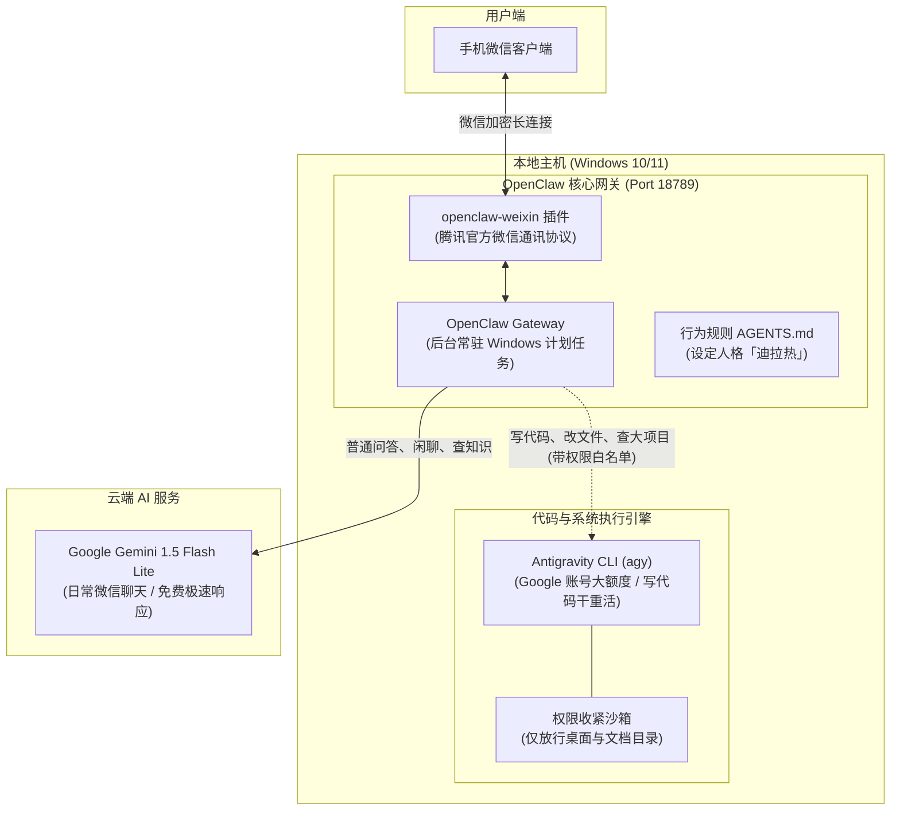

# 微信 AI 助手（ClawBot + Antigravity）完整配置与部署详解

本文档记录了从零搭建、排错并调优「微信 AI 助手」的完整技术方案。包含了系统架构、各组件的部署方式、Antigravity（`agy`）权限安全收紧与自动配置机制、核心踩坑经验复盘，以及日常运维操作速查。

---

## 一、 系统架构全景

整个系统由 **运行底座**、**微信通讯通道**、**云端 AI 大脑** 与 **本地干重活引擎** 协同运作：



### 组件分工与职责

| 组件名称 | 版本 / 技术栈 | 职责与作用 |
|---|---|---|
| **OpenClaw** | 2026.9.9 (Node.js 24) | 整个系统的中枢底座。提供常驻后台网关（Gateway）、会话管理、插件运行时和工具执行权限管控。 |
| **openclaw-weixin** | @tencent-weixin 2.4.8 | 腾讯官方微信插件。打通微信扫码登录、私聊/群聊消息监听与自动收发。 |
| **Gemini AI** | `gemini-flash-lite-latest` | 默认日常聊天大脑。响应极快、免绑信用卡，用于微信内日常闲聊、信息整理与问答。 |
| **Antigravity CLI** | 1.3.3 (`agy.exe`) | 本地高算力引擎。绑定 Google 开发者账号，具有大上下文与工具执行能力；专用于让微信助手编写代码、整理电脑文件。 |
| **AGENTS.md** | Markdown 规则规范 | 定义微信助手的专属人格（「迪拉热」），强制限制输出不可带有微信不兼容的 Markdown 标签，并建立安全防范红线。 |

---

## 二、 完整部署与配置流程

### 1. 运行环境初始化
- **操作系统要求**：Windows 10 64位 或 Windows 11。
- **环境基石**：
  - Node.js `v24.20.0`（OpenClaw 底层依赖）。
  - PowerShell 5.1 / PowerShell 7。
  - 用户本地目录权限：所有组件均安装在当前用户目录（`C:\Users\<username>`），严格**禁止以管理员身份提权运行**，避免计划任务与微信凭据跨账户丢失。

### 2. OpenClaw 底座与微信通道安装
通过执行初始化流程：
```powershell
# 1. 安装 OpenClaw
Invoke-RestMethod -Uri 'https://openclaw.ai/install.ps1' -UseBasicParsing | iex

# 2. 安装并启用腾讯微信通道插件
openclaw plugins install '@tencent-weixin/openclaw-weixin'
openclaw config set plugins.entries.openclaw-weixin.enabled true
```

### 3. 配置 Google Gemini 双通道 Provider
在 OpenClaw 中接入 Google 生成式 AI 时，必须严格遵循模型层级配置标准：
```powershell
# 写入 Google Provider、BaseUrl 与模型描述声明
openclaw config set models.providers.google @'
{
  "api": "google-generative-ai",
  "baseUrl": "https://generativelanguage.googleapis.com/v1beta",
  "apiKey": "你的API密钥",
  "models": [
    {
      "id": "gemini-flash-lite-latest",
      "name": "Gemini Flash Lite",
      "api": "google-generative-ai",
      "input": ["text"],
      "contextWindow": 1000000,
      "contextTokens": 200000,
      "maxTokens": 8192,
      "cost": { "input": 0, "output": 0, "cacheRead": 0, "cacheWrite": 0 }
    }
  ]
}
'@ --strict-json --merge

# 设置默认主模型为 Gemini Flash Lite
openclaw config set agents.defaults.model.primary "google/gemini-flash-lite-latest"
```

### 4. 注册并启动开机自启 Gateway 服务
```powershell
openclaw config set gateway.mode local
openclaw gateway install --force
openclaw gateway restart
```
服务将在后台作为 Windows 计划任务运行，绑定本地端口 `127.0.0.1:18789`，开机自动静默拉起。

### 5. 注入微信定制人格规则 (`AGENTS.md`)
在 `~/.openclaw/workspace/AGENTS.md` 写入助手的专属规则：
1. **微信排版适配**：由于微信无法渲染 Markdown，禁止助手使用 `#` 标题、HTML 标签、代码围栏包裹长文字等，改用纯文本数字序号。
2. **术语人话转换**：将 `API / Quota` 替换为「额度」，将 `Git / Commit` 替换为「文件夹版本」，将报错堆栈转换为通俗建议。
3. **安全红线**：严禁自动群发消息，防范封号风险；未授权的访客需经过配对审批（`dmPolicy: pairing`）。

---

## 三、 Antigravity (`agy`) 深度配置与安全控制

为了让微信助手具备写代码、改文件、管理本地项目的能力，同时防范 AI 误删系统文件或窃取机密，我们为 `agy` 实施了系统级的权限收紧方案。

### 1. 为什么无需手动走卡顿的 TUI 引导？
在传统 PowerShell 5.1（conhost 控制台）中运行 `agy` 会进入基于全屏 VT100 终端的交互向导（选配色、条款勾选），由于底层键盘缓冲区映射问题，常出现 **按回车、方向键无任何反应** 的假死状态。

我们采用 **静默状态写入机制** 绕过了该问题：
- 在 `~/.gemini/antigravity-cli/cache/onboarding.json` 写入已完成标志：
  ```json
  {
    "consumerOnboardingComplete": true,
    "enterpriseOnboardingComplete": true,
    "onboardingComplete": true
  }
  ```
- 探测并复用本地现有 Google 认证上下文：由于当前环境已有 Google Antigravity 登录凭据，静默调用 `agy -p "ping"` 可直接通过校验并执行。

### 2. 权限安全收紧策略 (`agy-permissions.ps1`)
在 `~/.gemini/antigravity-cli/settings.json` 中配置严格的白名单与黑名单规则。

#### ⛔ 严格禁止项 (Deny)
- **机密凭证防盗**：
  - 封禁读取 `~/.ssh`、`~/.aws`、`~/.gnupg`、`~/.config`
  - 封禁读取 `AppData/Roaming/Microsoft/Crypto`
  - 封禁读取 `settings.json` 本身（防止 AI 自行修改权限）
- **核心系统防篡改**：
  - 封禁写入 `C:/Windows`、`C:/Program Files`、`AppData`、`~/.openclaw`
- **高危破坏性与外发命令拦截**：
  - 封禁提权命令：`runas`
  - 封禁删除命令：`del`、`rm`、`Remove-Item`
  - 封禁系统级命令：`shutdown`、`reg`、`sc`、`schtasks`、`net`
  - 封禁网络外泄与远程操作：`ssh`、`scp`、`curl`、`wget`、`Invoke-WebRequest`、`Invoke-RestMethod`
  - 封禁代码推仓：`git push`、`npm publish`、`gh release`
  - 封禁通过子进程穿透沙箱的命令：`python -c`、`node -e`、`powershell -Command` 等

#### ✅ 允许操作项 (Allow)
- **限定工作空间**：仅允许读取和写入用户的 **「桌面」**（`Desktop`）和 **「文档」**（`Documents`）目录。
- **安全工程指令**：允许 `dir`、`where`、本地 `git status / diff / log / add`、`npm test`、`pytest` 等本地构建和测试命令。

### 3. OpenClaw 授权与白名单绑定
为了让 OpenClaw 后台服务在收到用户在微信中下发的写代码指令时能够合规拉起 `agy`，执行了白名单批准：
```powershell
$agyPath = (Get-Command agy).Source
openclaw approvals allowlist add --agent main $agyPath
```
此命令将 `agy.exe` 的执行路径加入了 SQLite 审批数据库，当助手的 Agent 需要使用 `agy` 解决重型编程任务时，无需在控制台人工点击二次确认。

---

## 四、 核心踩坑复盘与修复解决方案

在部署过程中我们遭遇了四个技术陷阱，均已在代码和配置中根治：

### 陷阱 1：PowerShell 5.1 编码乱码与 BOM 首行报错
- **现象**：在中文 Windows 系统的 PowerShell 5.1（GBK 代码页）下，执行无 BOM 的 `.ps1` 脚本时报 `The string is missing the terminator` 语法崩溃；而带 BOM 的脚本在通过 `irm | iex` 管道流式执行时，首行会报 `# : The term '#' is not recognized...`。
- **原因**：中文 Windows 默认把无 BOM 的 UTF-8 文件当作 ANSI/GBK 解析，汉字双字节破坏了单引号的配对闭合；而 `iex` 将首字节的 `\uFEFF` 与 `#` 当作了一个非法的 Cmdlet 名称。
- **根治措施**：
  1. 仓库内所有 `.ps1` 脚本强制保存为 **UTF-8 with BOM**（通过自检脚本保证）。
  2. 首行报错仅是第一行注释的提示，后续代码正常执行，无害忽略；若需纯净运行，可在命令中加入 `(irm ...).TrimStart([char]0xFEFF) | iex`。

### 陷阱 2：OpenClaw 自定义模型退化为 `openai-responses` 协议
- **现象**：配置模型后，测试对话报错：
  `Provider "google" requires an explicit base URL before using an OpenAI-compatible API`。
- **原因**：OpenClaw 内置模型目录默认未收录 `gemini-flash-lite-latest`。如果为 `google` 提供商显式添加自定义 `models` 数组，OpenClaw 会误将其识别为非官方的 OpenAI 兼容端点，协议退化为 `openai-responses` 并报错。
- **根治措施**：
  在 `models.providers.google` 中必须显式声明两个关键属性：
  - `"api": "google-generative-ai"`（明确告知走 Google 原生 API SDK）
  - `"baseUrl": "https://generativelanguage.googleapis.com/v1beta"`

### 陷阱 3：后台/AI 代理代跑时的「无弹窗」静默挂起
- **现象**：当安装脚本由 AI 助手（Cursor / Claude / Antigravity）在后台执行时，控制台输出「正在弹出一个新窗口」，但桌面上毫无动静，任务超时挂起。
- **原因**：父进程在无界面重定向沙箱中运行时，通过 `Start-Process powershell.exe -WindowStyle Normal` 生成的子进程继承了 Headless 状态（`MainWindowHandle == 0`），导致控制台没有分配到前台桌面窗口站（WinSta0）。
- **根治措施**：
  在 `Invoke-Visible` 函数中，升级为调用 `cmd.exe /c start /wait "窗口标题" powershell.exe ...`。Windows Shell 的 `start` 指令会显式向桌面系统请求 `CREATE_NEW_CONSOLE` 标志，强制弹出可见窗口。

### 陷阱 4：`agy` 交互式界面的按键假死
- **现象**：`agy` 进入选主题界面时按 Enter 或方向键无反应。
- **原因**：Windows 10 传统 conhost 控制台与 full-screen TUI 存在键盘 Raw Input 捕获冲突。
- **根治措施**：
  1. 在脚本中增加了轻量级无交互探测（`agy -p "ping"`），若已有环境则自动写入 `onboarding.json`，跳过繁琐的交互向导。
  2. 撰写文档告知用户使用现代化 **Windows Terminal** 或直接按 `Ctrl + C` 退出。

---

## 五、 日常运维与常用排查命令速查

### 1. 服务健康检查
```powershell
# 检查后台网关状态 (应显示 Runtime: running, Connectivity probe: ok)
openclaw gateway status

# 检查微信通道状态 (应显示 openclaw-weixin: enabled, configured, running)
openclaw channels status

# 测试助手端到端对话响应
openclaw agent --message "你好，测试连接"
```

### 2. 微信掉线重连
如果微信通道意外断开或二维码过期，**无需重新运行安装脚本**，在项目目录下执行：
- Windows：直接双击运行根目录下的 **`扫码登录-Windows.bat`**
- 或在 PowerShell 中执行命令：
  ```powershell
  openclaw channels login --channel openclaw-weixin
  ```

### 3. 重启后台服务
当修改了代理端口、Gemini 密钥或助手规则后，需要重启网关使配置生效：
```powershell
openclaw gateway restart
```

### 4. 日志文件路径速查
| 日志用途 | 物理存储路径 |
|---|---|
| **微信助手运行时日志** | `C:\Users\<用户名>\AppData\Local\Temp\openclaw\openclaw-YYYY-MM-DD.log` |
| **一键安装器记录** | `C:\Users\<用户名>\AppData\Local\clawbot-wechat\install.log` |
| **Antigravity CLI 日志** | `C:\Users\<用户名>\.gemini\antigravity-cli\log\cli-*.log` |
| **助手规则与工作空间** | `C:\Users\<用户名>\.openclaw\workspace\AGENTS.md` |
